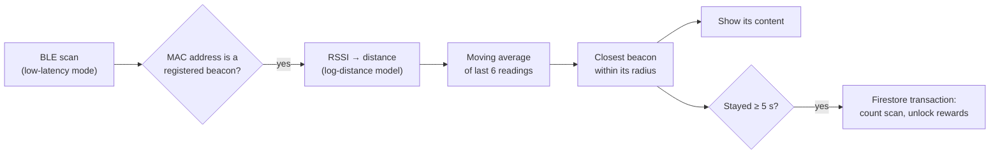

# 📡 BLE Advert

An Android app for **proximity-based content and rewards** using Bluetooth Low Energy beacons. Walk up to a beacon and the app shows the web content tied to it. Visit enough beacons during an event and you unlock rewards.

Built as the practical part of my BSc thesis, *"Applications of Bluetooth Low Energy (BLE) technology in mobile applications"* (FERIT Osijek, 2024).


<!-- Screenshots: save phone screenshots in docs/ and uncomment.
<p align="center">
  
  
  
  
</p>
-->

---

## 💡 Use cases

**A museum or trade fair.** Each exhibit has a small beacon. Visitors who walk up to it see its information page on their phone without scanning a QR code. Visiting a set number of exhibits during the event unlocks a reward such as a discount or a badge.

---

## ✨ Features

### For visitors
- **Proximity content.** While scanning, the app finds the nearest beacon in range and shows the web page assigned to it.
- **Events and rewards.** Admins run time-limited events. Each unique beacon you visit counts as a scan, and rewards unlock at set scan thresholds.
- **History.** See the events you took part in and the rewards you earned.
- **Guest mode.** Browse content without an account. Progress and rewards need sign-in.
- **Stay signed in** between launches, plus password reset.

### For admins
- **Beacons.** Register, edit and delete beacons by MAC address, with a content URL, a position in the venue and a trigger radius.
- **Events.** Create events with a title, description, cover image, start and end dates, and a list of rewards with their required scan counts. Expired events are closed automatically.
- **Admin rights.** Grant or revoke admin privileges for other users by email.

---

## ⚙️ How proximity detection works



1. **Matching.** The app scans in low-latency mode and ignores every device whose MAC address isn't a registered beacon.
2. **Distance estimate.** Signal strength (RSSI) is converted to distance with the log-distance path-loss model: `d = 10^((RSSI₀ − RSSI) / (10·n))`, with RSSI₀ = −59 dBm at 1 m and n = 2.
3. **Smoothing.** Raw RSSI is noisy, so each beacon keeps a moving average of its last 6 distance readings.
4. **Closest beacon.** The nearest beacon is the one with the smallest average distance that is still inside its own trigger radius (1.25 m by default). Its content is shown.
5. **Dwell time.** A visit only counts after the user stays near the same beacon for **5 seconds**. This filters out people just walking past. Time spent at each beacon is stored as well.
6. **Rewards.** A visit runs in a single **Firestore transaction**. It records the beacon, increments the user's scan count for the event and unlocks every reward whose threshold is now met. The same beacon never counts twice per event.

---

## 🏗️ How it's built

| Layer | What's used |
|---|---|
| UI | Jetpack Compose, Material 3, Navigation Compose, Coil, an embedded WebView for beacon content |
| State | ViewModels with `StateFlow`, Kotlin coroutines |
| Bluetooth | Android `BluetoothLeScanner`, runtime permission flow for Bluetooth and location |
| Backend | Firebase Authentication, Cloud Firestore (users, beacons, events, progress), Firebase Storage (event and reward images) |
| Local | DataStore Preferences for staying signed in |

```
app/src/main/java/com/domagojleskovic/bleadvert/
  MainActivity.kt            BLE scanning, RSSI → distance, navigation
  DatabaseAccessObject.kt    all Firestore and Storage access
  Beacon, Event, Reward,     data models
  UserEventProgress, User
  ui/                        Home, Rewards, ScannedHistory, AdminPanel,
                             ModifyBeacons, Login, Register, PermissionDialog
  viewmodels/                one ViewModel per screen, plus a shared one
```

---

## 🚀 Running it

**Requirements:**
- Android Studio (Iguana or newer) and JDK 17
- A **physical Android phone** on 7.0+ (emulators can't scan for BLE)
- At least one BLE beacon. Any BLE device that advertises works, since beacons are matched by MAC address.

**Steps:**
1. Clone the repo, open it in Android Studio and run the `app` configuration on your phone.
2. Allow the Bluetooth and location permissions when asked.
3. The app is connected to my Firebase project through `app/google-services.json`. To use your own:
   1. Create a Firebase project.
   2. Enable **Email/Password** authentication, **Cloud Firestore** and **Storage**.
   3. Replace `app/google-services.json` with your own.
4. To make your first admin, set `admin: true` on your user's `info/generalInfo` document in Firestore. After that, admins can promote others from inside the app.

---

## 📝 Notes

- RSSI-based distance is approximate. Walls, bodies and phone models all shift it, which is why the app smooths readings and uses a per-beacon trigger radius rather than exact distances.
- Beacon positions (x, y) are stored with each beacon but not yet used. They're groundwork for indoor positioning by trilateration.
